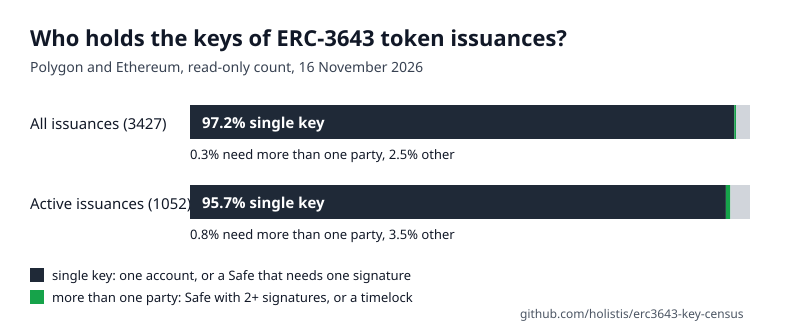

# Censo de control de claves de ERC-3643

¿Quién tiene las claves de las emisiones de tokens ERC-3643 en Polygon y Ethereum? Este repositorio lo cuenta. Todo se leyó de cadenas públicas. No se escribió nada en ninguna cadena ni se probó nada contra ningún contrato.

Las cifras y sus frases completas están en el [README en inglés](README.md) y se vuelven a calcular con `node check.mjs`.

## Qué se midió

Para cada token creado mediante el evento estándar `TREXSuiteDeployed` de una fábrica ERC-3643, en ambas cadenas y hasta el bloque de la medición, se leyó `owner()` y se siguió la cadena de propietarios hasta una cuenta, un Safe, un timelock o un punto muerto.

"Una sola clave" significa una sola dirección de cuenta, o un Safe que solo necesita una firma. "Varias partes" significa un Safe con umbral de dos o más, o un timelock.

## Lo que esto no muestra

- Una dirección de cuenta puede estar respaldada por un sistema de custodia (MPC, HSM, un custodio). Eso no se ve en la cadena, así que "una sola clave" quiere decir "una sola dirección".
- Las cifras de arriba miden solo el rol `owner()`. Los agentes, que pueden emitir, congelar o transferir por la fuerza, se miden en la sección "Agents and levels" del README en inglés, con los niveles definidos en LEVELS.md.
- Solo están las emisiones creadas con el evento estándar de la fábrica.
- Es una observación sobre quién puede actuar. No afirma que algo esté mal, no nombra a ningún emisor ni plataforma y no hace ninguna afirmación sobre un emisor concreto.

## Cómo recontarlo

Node 22 o superior, sin dependencias: `node check.mjs`, `node check.mjs --selftest`, `node check.mjs --verify-chain`, `node --test`.

Las correcciones se anotan aquí y nunca son silenciosas. Si recuentas y obtienes otra cifra, abre un issue con tu comando y el número de bloque. Los recuentos de terceros son bienvenidos y se citarán en este README.

## Cómo citar

holistis (github.com/holistis), ERC-3643 key-control census, 16 de noviembre de 2026, https://github.com/holistis/erc3643-key-census

## Licencia

Código: MIT. Datos en `data/`: CC BY 4.0, por favor citar como arriba.
