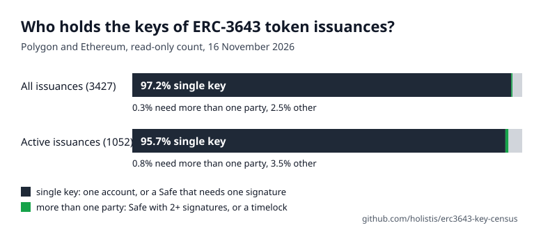

# ERC-3643 key-control census

Who holds the keys of ERC-3643 token issuances on Polygon and Ethereum? This repository counts it. Everything was read from public chains. Nothing was written to a chain, tested against, or touched.

Spanish summary: [README.es.md](README.es.md)

## The numbers



<!--SUMMARY-->
Of 3427 token issuances (3363 on Polygon, 64 on Ethereum), 97.2% have a single account or a Safe that needs one signature as owner, and 0.3% need more than one party (a Safe with a threshold of two or more, or a timelock that answers getMinDelay()).
Among the 1052 active issuances (supply above zero, not paused) the shares are 95.7% and 0.8%.
The 50 largest of the 222 distinct final controllers of active issuances are the final controller of 80% of the active issuances (counted per issuance, not by supply).
The 3427 issuances come from 222 distinct factory contracts that emitted the standard event. Anyone can deploy such a factory, so the list includes small and test deployments.
Measured on 2026-11-16 at Polygon block 97439700 and Ethereum block 26430325.
<!--/SUMMARY-->

<!--NUMBERS {"tokens":3427,"active":1052,"single_key_pct_all":97.2,"multi_party_pct_all":0.3,"single_key_pct_active":95.7,"multi_party_pct_active":0.8,"distinct_factories":222,"distinct_controllers_active":222,"top50_controllers_share_active_pct":80,"discarded":{"duplicates_skipped":0,"invalid_address_skipped":0,"transport_failures":0,"unreadable":0}} -->

Data fingerprint (sha256 of data/tokens.json): `5d8aa148e0c497dee6171809c103a484abfd8a0cf587f0b969fec57407a90356`

"Active" means total supply above zero and not paused. Supply is counted in token units, not in money, and many issuances are small or are tests. Shares are counted per issuance, not by supply.

## How the list was made

`node discover.mjs` lists every token announced by the standard `TREXSuiteDeployed` event (topic0 `0x057adae5fa3e9caa8a0d584edff60f61558d33f073412ec2d66d558b739e0a41`) on both chains, from block 0 to the block recorded in `data/discovery.json`. Any contract that emits this event counts as a factory, and anyone can deploy one, so the list includes small, hobby and test deployments. The factory count is in the numbers above. The default log source is a public gateway that returns the full history in one call; it can change or disappear, so `--rpc` and `--chunk` let you use another node.

## What was measured

For every token in that list:

1. Read `symbol()`, `totalSupply()`, `paused()` and `owner()` through Multicall3. Symbols are used only to see whether a token answers; they are not published.
2. Follow `owner()` through contracts until it reaches an account, a Safe, a timelock, or a dead end. The last stop is called the final controller.
3. Classify the result:

| type | meaning |
|---|---|
| account_direct | `owner()` is an account (no code, or an EIP-7702 delegated account) |
| account_via_contract | `owner()` is a contract whose `owner()` chain ends at an account |
| safe_threshold_1 | a Safe where one signature is enough |
| safe_multisig | a Safe with a threshold of two or more |
| timelock | a contract that answers `getMinDelay()` |
| other_contract | a contract that is none of the above, including timelocks and governors that do not answer `getMinDelay()` |
| renounced | the owner is the zero address or `0x...dead` (not counted as a controller) |
| no_owner, self_owned, cycle, too_deep, not_measured, unreadable | edge cases, all counted |

An account with exactly 23 bytes of code that starts with `0xef0100` (EIP-7702 delegation) is counted as an account.

Single key means: one account address, or a Safe that needs only one signature. Multi party means: a Safe with a threshold of two or more, or a timelock that answers `getMinDelay()`.

## What this does not show

- An account address can be backed by custody software (MPC, HSM, a custodian). That cannot be seen on a chain, so "single key" means "a single address", not "a single private key".
- The numbers at the top measure the `owner()` role only. Agents, who in ERC-3643 can mint, freeze or force transfers, are measured in the next section. Only the agents of the token contract are read, not those of its identity registry.
- A Safe with a threshold of two or more is counted as multi party even when a module (for example a delay or roles module) lets fewer signers act. A timelock is counted as multi party even when one account proposes. Compound-style timelocks and governors are in other_contract.
- Only issuances announced by the standard factory event are in the list. Issuers that deploy in another way are not.
- Supply is not value. A large share of issuances is probably small or test deployments.
- This is an observation about who can act. It is not a statement that anything is wrong. No issuer or platform is named, and no claim is made about any specific issuer. Addresses are public chain data.

## Agents and levels

In ERC-3643 the owner adds and removes agents, and every agent can mint, burn, freeze and force transfers on its own (`onlyAgent` in the T-REX token contract). So the owner is only half of the picture. `node agents.mjs data/tokens.json data` reads the public `AgentAdded` and `AgentRemoved` events of every token in the list, replays them in order, and classifies each current agent the same way as the owner.

<!--AGENTSUMMARY-->
Of 3427 token issuances, 3186 have at least one agent (789 distinct agent addresses in total). In ERC-3643 an agent can mint, burn, freeze and force transfers on its own, and the owner can add and remove agents.
86.2% of all issuances, and 90.2% of the 1052 active ones, have at least one agent that is directly an account or a Safe that needs one signature. Counting also agents that are contracts whose owner() chain ends at an account, the shares are 91.9% and 97.2%.
By the weakest role holder (the owner and every agent), 98.5% of issuances are at Level 0, 0.3% at Level 1 and 1.2% are not classified. Among the active issuances the shares are 97.2%, 0.8% and 2%.
No issuance whose owner is a Safe with a threshold of two or more is held at Level 0 by a single-key agent.
Event counts behind the agent list: 6633 AgentAdded, 547 AgentRemoved, 0 repeated adds and 0 removals of an agent that was not listed, which leaves 6086 agents.
Agent events were read up to Polygon block 97478850 and Ethereum block 26435223.
<!--/AGENTSUMMARY-->

<!--AGENTNUMBERS {"tokens_with_agents":3186,"agents_distinct":789,"single_key_agent_direct_pct_all":86.2,"single_key_agent_direct_pct_active":90.2,"single_key_agent_pct_all":91.9,"single_key_agent_pct_active":97.2,"level0_pct_all":98.5,"level1_pct_all":0.3,"not_classified_pct_all":1.2,"level0_pct_active":97.2,"level1_pct_active":0.8,"not_classified_pct_active":2,"owner_multisig_held_down":0} -->

Agent data fingerprint (sha256 of data/agents.json): `f2bba33d1211a970441367094d1b71311026014877de0c9895e8abe1faf5e35e`

The agent data is one snapshot, like `data/tokens.json`. It is not part of the weekly series yet. Agents were read up to the blocks above, while the agent addresses were classified at the time the script ran, so a later recount can differ where an owner or a Safe changed since.

Levels are defined in [LEVELS.md](LEVELS.md). Level 0 means at least one role holder is a single key that can act alone. Level 1 means every role holder is a Safe that needs two or more signatures. Levels describe structure, not safety. `check.mjs` also checks the agent data: the rows against the token list, the level of every row, the counts and the number of agents against the event counts, so an agent dropped or invented on its own is seen. Moving agents between rows in a consistently edited copy is not seen offline, only by a recount.

## Recount it yourself

Node 22 or newer (tested on 24 and, in CI, 22). No dependencies.

```
node check.mjs                  # offline recount: data, summary, README numbers and sentences, chart, discovery counts, fingerprint
node check.mjs --selftest       # plants errors in a copy and requires every one to be caught
node check.mjs --verify-chain   # re-measures a deterministic sample of 200 tokens from the chains (type and controller); red above 5 percent difference, --strict for any
node discover.mjs list.json     # rebuilds the token list from the chains
node census.mjs list.json out/  # re-measures every token (numbers drift as owners change and new issuances appear)
node check.mjs --compare out/tokens.json   # compares your full recount with data/tokens.json
node check.mjs --verify-agents   # asks the token contracts themselves isAgent(address) for a deterministic sample of 300 listed agents; red above 5 percent no, --strict for any
node agents.mjs data/tokens.json out/   # re-reads the agent events up to the latest block and re-classifies every agent
node history.mjs update --census out/   # record a new measurement in history/ (refused if it cannot be complete)
node --test                     # unit tests, including a mock RPC server for discovery and for the whole counting process
```

`check.mjs --selftest` plants at least thirty errors in a copy of the data (a fake id, a flipped type, one row removed, an empty list, a truncated file, a changed number in the README and more) and fails if any of them goes unnoticed. `test/meta.test.mjs` then disables the checks one at a time and requires the selftest to turn red. One limit is known: a simultaneous and consistent edit of rows, summary, fingerprint and README cannot be seen offline. `--verify-chain` would catch it only if an edited row is in the sample. A full recount followed by `--compare` catches all of it.

An early version of the classifier counted accounts with EIP-7702 delegation as contracts. That was found by sampling on a second node, corrected, and is now covered by tests.

Counts of anything skipped, duplicated or unreadable are part of the numbers block above, under `discarded`.

## History

`data/` is the frozen first snapshot of 16 November 2026, which the numbers above describe. A scheduled job measures again every week and records one row in [history/series.csv](history/series.csv), the state in [history/latest.json](history/latest.json) and, when something moved, what moved in `history/changes/`. The job refuses to record a measurement that cannot be complete: issuances are announced by an event and cannot be un-announced, so the list only grows, and a measurement with fewer tokens than before is thrown away. `node check.mjs` checks the history files offline.

## Break our counter

Find a counting error and you are credited in [RECOUNTS.md](RECOUNTS.md). The challenge is open in [issue 1](https://github.com/holistis/erc3643-key-census/issues/1): a wrong type or controller, a token missing from the list, or a planted error that the recount script lets through. There is no bounty, only credit.

## For AI agents

See [AGENTS.md](AGENTS.md) and [llms.txt](llms.txt) for how to quote the numbers without overclaiming.

## Corrections and recounts

Corrections are listed here and are never silent. If you recount and get a different number, please open an issue with your command and block number. Recounts by others are welcome and will be credited in this README.

## Cite as

holistis (github.com/holistis), ERC-3643 key-control census, 16 November 2026, https://github.com/holistis/erc3643-key-census

Archived on Zenodo: DOI 10.5281/zenodo.24323265 (always the latest version). Version 1.1.0: DOI 10.5281/zenodo.24323266, https://doi.org/10.5281/zenodo.24323266

## License

Code: MIT, see LICENSE. Data in `data/`: CC BY 4.0, please cite as above.
